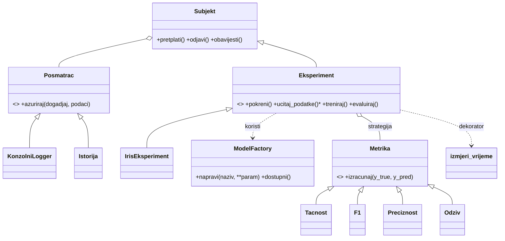

# Mini okvir za ML eksperimente

Mali okvir u Pythonu koji pokazuje pet projektnih šablona na scikit-learn modelima i skupu *iris*.

| Šablon | Gdje | Svrha |
|---|---|---|
| Factory | `mlokvir/factory.py` | kreira model po imenu (linearni, stablo, kNN) |
| Strategy | `mlokvir/metrike.py` | zamjenjive metrike (tačnost, F1, preciznost, odziv) |
| Observer | `mlokvir/posmatraci.py` | praćenje toka treninga (logger, istorija) |
| Template Method | `mlokvir/eksperiment.py` | fiksni tok eksperimenta, koraci se nadjačavaju |
| Decorator | `mlokvir/dekoratori.py` | mjerenje vremena treninga |

## Pokretanje
```bash
pip install -r requirements.txt
python demo.py
pytest
```

## Dijagram klasa


## Upotreba AI alata
- **Alat:** Claude (Anthropic).
- **Za šta je korišten:** AI je generisao početnu verziju projekta (strukturu paketa, implementaciju pet šablona, demonstraciju na skupu iris, pytest testove i nacrt ovog README-a) na osnovu teksta zadatka.
- **Šta je urađeno uz AI:** pokrenuta je demonstracija i testovi, a AI je ispravio grešku u kojoj je događaj `trening_gotov` slao vrijeme `None` (vrijeme se postavljalo tek nakon povratka iz dekorisane metode).
- **Moja provjera:** pregledala sam kod te pokrenula demonstraciju i testove kako bih provjerila da sve funkcioniše ispravno.
- **Šta sam naučila:** kako se koriste šabloni Factory, Strategy, Observer, Template Method i Decorator i kako oni olakšavaju organizaciju i ponovno korišćenje koda.
- **Napomena:** kod, testovi, dijagram i nacrt ovog README-a nastali su uz AI alat; AI je pokrenuo demonstraciju i testove u svom okruženju (8 testova je prošlo).
